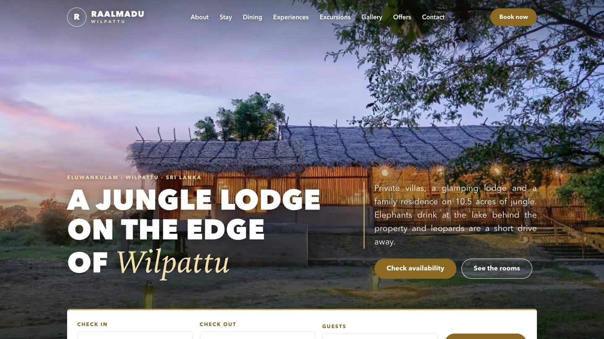
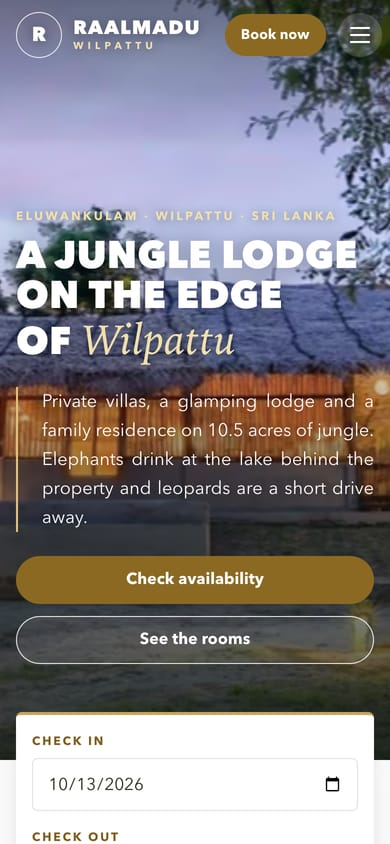

<div align="center">



# Raalmadu Wilpattu

**A website for a jungle lodge where the elephants come to drink at the lake behind the rooms.**

*Ten minutes from the Eluwankulam gate of Wilpattu National Park, Sri Lanka*

`hand-built SSG` · `zero runtime dependencies` · `zero web fonts` · `zero layout shift` · `WCAG 2.1 AA`

</div>

---

## 🌅 At first light

Raalmadu is 10.5 acres of dry-zone jungle on the Puttalam side of Wilpattu:
private plunge-pool villas, a glamping lodge and a family residence, solar
powered, a river at the front and a lake at the back. The guests who stay
there come for leopards, sloth bears, painted storks and quiet.

The site's job is to make a guest feel that quiet before they book, then let
them book without fuss. So it is built like the lodge: small, solid, nothing
borrowed that it doesn't need.

- **No framework.** One Node script (`build.js`) turns plain data modules into plain HTML.
- **No runtime dependencies.** About 6 KB of hand-written JavaScript, deferred.
- **No web fonts.** The type is set from system fonts, so the first paint waits on nothing.
- **No guesswork.** Three audit scripts gate every deploy: SEO, responsive layout, and runtime/accessibility.



## 🧭 Setting out

```bash
git clone https://github.com/tharukaGamage01/Raalmadu-Wilpattu.git
cd Raalmadu-Wilpattu
npm install              # sharp (images) + puppeteer-core & axe-core (audits)
npm run images:optimize  # build the responsive image set (needed once per clone)
npm run dev              # build + serve on http://localhost:4173
```

> **Why `images:optimize` first?** The ~50 MB of AVIF/WebP/JPEG derivatives are
> gitignored because they can be rebuilt exactly from the tracked sources in
> `assets/images/src/`. `npm run build` refuses to run without them rather than
> ship a site where every `` is a 404.

| Command | What it does |
|---|---|
| `npm run dev` | Build and serve locally |
| `npm run build` | Render `dist/` |
| `npm run verify` | Build, then run **all three audits** — run this before every deploy |
| `npm run images:optimize` | Regenerate derivatives after swapping a photo |
| `npm run images:sheet` | Every image in one labelled grid at `.qa/contact-sheet.jpg` |
| `npm run vercel-build` | `images:optimize` + `build` — what a host CI runs |

<br clear="right">

## 🐾 The three trackers

Every build is followed by three scripts that act like trackers on a game drive: each looks for one kind of problem, and the deploy waits until all three come back clean.

| Tracker | Looks for | Stops the deploy on |
|---|---|---|
| `npm run check` | Titles, descriptions, canonicals, robots directives, heading order, alt text, JSON-LD, sitemap, every internal link | any error |
| `npm run qa` | Headless Chrome at 360 / 390 / 768 / 1280 / 1680 px: horizontal overflow, mobile nav, tap-target size | any error |
| `npm run audit` | JS errors, failed requests, broken images, axe-core WCAG 2.1 AA, and smoke tests for nav, lightbox, booking hand-off, date sync, form validation and the skip link | serious / critical |

## 🗺️ The lie of the land

```
build.js                  the generator → dist/
src/
  data/                   ← text is data, not markup
    site.js               domain, contact, geo, policies — single source of truth
    rooms.js              room inventory (one entry = page + card + sitemap + schema)
    content.js            facilities, experiences, offers, FAQs, guest reviews
    images.js             image registry: alt text + aspect ratio
    image-manifest.json   generated: real dimensions + blur-up placeholders
  lib/
    layout.js             the HTML shell — every meta, OG and canonical tag
    schema.js             the JSON-LD graph
    components.js         <picture>, cards, booking widget
    sections.js           page heroes, CTA bands, accordion
    icons.js              inline line icons
  pages/                  one module per page group
  styles/main.css         the whole design system, inlined into every page
  scripts/main.js         nav, sticky header, hero + review carousels, lightbox, date sync
scripts/                  image pipeline, audits, local server
docs/                     Search Console + backlink playbooks, README images
dist/                     build output — deploy this (gitignored)
```

**Want to change what the site says?** Edit `src/data/`, not HTML. Add a room
and its page, card, sitemap entry and `HotelRoom` schema all appear on the next
build. Add an FAQ and the `FAQPage` schema grows with it. Add a review to
`testimonials` in `content.js` and it joins the home-page carousel.

## 📸 The photographs

The site uses two kinds of photography:

- **The lodge itself: 18 photographs from the hotel.** These are the full-resolution
  originals from the property's Booking.com gallery, used with the owner's
  permission. Most are 2048 px on the long edge; the newer room set is 1280 px.
- **The park around it: 13 Creative Commons wildlife and landscape photographs.**
  The lodge has no leopard or elephant photography of its own, so these show
  Wilpattu rather than the property. Each one is credited in [NOTICE](NOTICE)
  and on `/image-credits/`.

Every image goes through one pipeline: AVIF → WebP → JPEG at five widths, never
upscaled, with intrinsic `width`/`height` and an inline blur-up placeholder.
That is how the site holds **CLS at 0.0000**.

**To swap in a new photo:** drop it into `assets/images/src/` under the existing
filename, update its `alt` in `src/data/images.js`, then run
`npm run images:optimize && npm run build`.

## 🎨 The look

The direction is light and natural, after the safari lodges of Yala: paper-white
pages, full-bleed photo heroes, bold uppercase olive titles with one word picked
out in gold serif italic, gold pill buttons, tilted "polaroid" photos, and a
few deep forest-green bands to rest the eye (the at-a-glance strip, the reviews,
the footer).

Two colour traps to keep in mind, since everything is checked against WCAG 2.1 AA (4.5:1):

- `--olive` reaches only 4.45:1 on `--cream`, so links default to `--olive-dark`.
- `--gold` (`#9c7428`) is for large title accents only. Gold buttons use the darker `--gold-btn` (white text at 5.0:1).

Hero text animates in by unmasking (clip-path) rather than fading, because axe
measures contrast mid-fade. Change a colour, re-run `npm run audit`.

## 🔍 Built to be found

Every rule below is enforced by the build and re-checked by `npm run check`.

| | |
|---|---|
| **Titles** | Unique per page, ≤ 65 characters. The build fails otherwise. |
| **Descriptions** | Unique, 70–165 characters. The build fails otherwise. |
| **Headings** | Exactly one `<h1>` per page and no skipped levels. |
| **Canonicals** | Self-referencing, absolute, HTTPS, derived from `SITE_URL`. |
| **Robots** | `index, follow` everywhere except the 404. The sitemap is generated, and CSS/JS/images are never blocked. |
| **Schema** | A connected JSON-LD `@graph`: `Hotel`, `WebSite`, `WebPage`, `BreadcrumbList`, `HotelRoom` + `Offer` + `ReserveAction`, `FAQPage`, `ImageGallery`, `ContactPage`. |
| **Speed** | Inlined CSS, hero preloaded as AVIF with `fetchpriority="high"`, no fonts, no layout-forcing scroll handlers. |

> **Deliberately not marked up: `aggregateRating`.** The 9.0/10 score and the
> guest reviews come from Booking.com. Google treats third-party ratings on a
> `LocalBusiness` as ineligible and can issue a manual action, so they stay in
> the page and out of the graph.

Two jobs need the owner rather than the code:
[Search Console verification](docs/search-console-setup.md) and the
[backlink plan](docs/backlink-strategy.md).

## ✅ Before the gates open

Everything below lives in `src/data/site.js`, and every unconfirmed value there
is tagged `VERIFY:`. Confirm them with the owner before launch.

| What | Where | Status |
|---|---|---|
| Domain | `SITE_URL` | `https://www.raalmaduwilpattu.com` — drives every canonical, OG URL and sitemap entry |
| Phone · Email · Address · Coordinates · Maps link | `site.contact`, `site.address`, `site.geo`, `site.mapUrl` | confirmed |
| WhatsApp | `site.contact.whatsapp` | **check** — old line, not yet confirmed |
| Facebook / Instagram | `site.social` | empty |
| Rates | `rateFrom` in `src/data/rooms.js` | from the Booking.com listing |
| Review score | `site.rating` | 9.0 / 10 from 85 Booking.com reviews; refresh periodically |

> **NAP check.** The Google Business Profile is titled *"Raalmadu Resort -
> Eluwankulama"* while the site and Booking.com say *"Raalmadu Wilpattu"*.
> Renaming the Google listing to match helps Google tie the three together.

## 🚙 Into the field (deployment)

`dist/` is a plain static folder, and host config is generated into it on every
build. Because the image derivatives are gitignored, **every host must run the
optimiser before the build:** `npm run images:optimize && npm run build`.

| Host | Setup |
|---|---|
| **Vercel** | Nothing to configure. The root `vercel.json` already points `buildCommand` at `npm run vercel-build` and the output at `dist`. |
| **Netlify / Cloudflare Pages** | Build command as above, publish `dist`. `_headers` and `_redirects` are picked up automatically. |
| **Apache / cPanel** | Upload `dist/`. The generated `.htaccess` handles HTTPS, clean URLs, headers and caching. |
| **Nginx** | No config is generated. Use `try_files $uri $uri/index.html =404`, add HSTS, and redirect the apex to `https://www.`. |

**Booking engine:** `/booking/` has a `[data-booking-engine]` mount point and
receives `?checkin=…&checkout=…&adults=…&room=…` from every booking widget on
the site. Wire the provider up in `src/scripts/main.js`, and add its origin to
the CSP `script-src` in `buildHeaders()`, which is currently `'self'` only.

**Contact form:** this ships as `provider: 'netlify'` in `site.forms`. On any
other host, switch to Formspree or similar, or to your own endpoint, and send a
real test submission before launch.

## 📜 Licence

**Code:** all rights reserved. See [LICENSE](LICENSE). The "Raalmadu Wilpattu"
name and branding are not licensed by it.

**Photography:** not covered by LICENSE.
- The hotel's own photographs belong to the property.
- The Creative Commons images keep their own licences (mostly CC BY-SA, whose share-alike terms apply regardless of LICENSE). Per-image attribution is in [NOTICE](NOTICE), which `npm run notice` regenerates.

<div align="center">
<br>

*Built for the jungle, tested like a bridge.*

🐘 🐆 🦅 🐊

</div>
